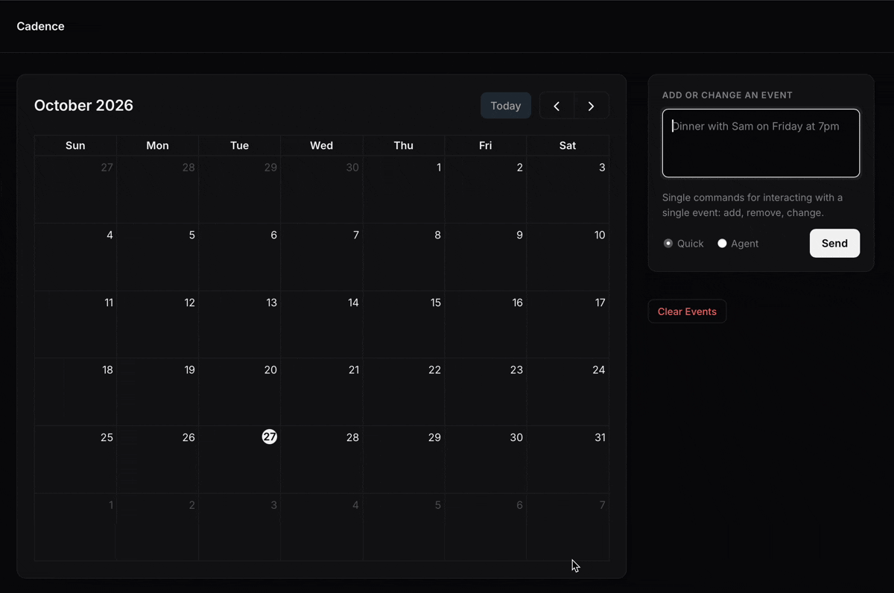

# Cadence

Type a sentence, get a calendar event. "Dinner with Alex Friday at 7" adds it, "move both standups to 10am" finds and updates two events, and overlapping events are held for you to confirm instead of silently saved.

**Live demo:** [https://cadence-cal.fly.dev]



## What it does

- **Quick mode** (`/command`): one LLM call turns a sentence into a structured add, update or remove. Works with Anthropic or a local Ollama model.
- **Agent mode** (`/agent`): a tool-using loop for multi-step requests ("cancel everything on Saturday and add a hike at 9am"). The model searches the calendar, then adds, updates and removes events, with a step cap.
- **Conflict detection**: an add or update that overlaps an existing event is not saved. It is held, and the user confirms or cancels with buttons. The agent has no confirm tool, so it cannot approve its own conflicting change.
- **Per-visitor sessions**: each visitor gets an anonymous cookie and their own calendar, so a public demo does not share state.
- **Rate limiting** on the LLM endpoints (`slowapi`, keyed by client IP).

## How it works

```
frontend (vanilla JS + FullCalendar-style grid)
        |
        v
FastAPI  --  /command  --> instructor + Pydantic --> LLM (Anthropic | Ollama)
   |     --  /agent    --> tool loop (Anthropic SDK) --+
   |                                                   |
   +---- store.py (SQLite, every query filtered by session_id) <-- tools: search_events,
                                                          add_event, update_event, remove_event
```

Design choices worth knowing:

- **Structured output for quick mode.** `instructor` validates the model's reply against Pydantic models (`AddEvent`, `UpdateEvent`, `RemoveEvent`) and retries on invalid output. A remove or update can only target an event id that exists in the visitor's calendar.
- **Hand-written agent loop.** The agent uses the Anthropic SDK directly with four tools. Tool inputs are validated with the same Pydantic models, and validation errors go back to the model as `is_error` tool results so it can correct itself. The session id is never part of a tool schema; the endpoint supplies it, so the model cannot reach another visitor's data.
- **The model does not do date math.** The prompt contains a lookup table of the next 7 days, and the model copies dates from it.
- **Hold, don't write.** Conflicting changes are stored as one pending action per session. Confirm (`POST /pending/confirm`) writes exactly what the user saw.

## Problems I ran into

**Date arithmetic in quick mode.** My first prompt just gave the model today's date and let it work out "Friday" or "next Tuesday". It got these wrong often enough to be unusable, and tweaking the wording only moved the failures around. The fix was to stop asking the model to calculate. `generate_next_n_days` builds a lookup table of the next 7 days and the prompt tells the model to copy the date for the weekday it sees. That raised its own edge case: if today is Friday, what does "Friday" mean? The table maps it to next week, and "today" or "tonight" are the only words that mean today. Because the date logic was now plain Python, I could test it, and this is what led to my first pytest file (`tests/test_date_utils.py`). It covers the same-weekday rule and a week that crosses a year boundary, which I would never have caught by trying prompts by hand.

**Ollama was too slow.** I started with a local model (`qwen2.5:7b` through Ollama) so the project would cost nothing to run. On my laptop each request took long enough that quick mode felt broken, and iterating on prompts meant waiting after every change. I switched to the Anthropic SDK with Claude Haiku, which made quick mode fast enough to feel instant and made it practical to build the agent loop on top. The provider factory (`llm/providers.py`) is still there, so Ollama works for quick mode, but agent mode needs the Anthropic tool-use API.

**Times without am/pm.** "Lunch at 1" is 13:00 and "breakfast at 8" is 08:00, but the model would sometimes pick the wrong half of the day. A blanket rule did not help, so the prompt now says to choose the more likely one for that kind of event and gives those two cases as examples. These became their own eval suite (Quick: times).

**Same-title events.** With two events called "standup", the model would pick the wrong one or the wrong id for "move the second standup". Two changes fixed it: `format_for_prompt` now lists the date first so events with the same title are easy to tell apart, and the prompt says to only pick an event whose title matches and to return `event_id: null` rather than guess. The instructor validator also rejects any id that is not in the visitor's calendar.

**Learning to prompt with examples.** My first prompts were pure instructions: a list of rules and nothing else. When the model got an update wrong (it filled in every field instead of only the changed ones), adding more rules made the prompt longer without fixing it. What worked was showing one concrete example next to the rule: "move dentist to Friday 3pm" is an update with the dentist's id, only `start_day_time` set, and everything else null. The same pattern fixed the am/pm cases. I learned that a rule says what I want, an example shows the exact output shape, and a short example often beats a paragraph of rules. I also learned to keep the number of examples small, since the model copies them closely and I did not want it to pattern-match on the wording of one.

**An eval failure that was my test's fault.** One early agent case had a "dentist" event and a "teeth cleaning" event, and I asked the agent to act on the dentist. It did not change anything. It stopped and asked me which event I meant. My eval counted that as a failure, but when I read the trace the agent was right: the request really could mean either one, and the agent prompt tells it to ask when several events plausibly match instead of picking one. I decided to keep that behavior and fix the test, not loosen the prompt to make the agent guess. The ambiguous cases ("Cancel the standup" with two standups) now expect the calendar to stay unchanged, and I reworded the other cases so each has one clear answer. The lesson was that when an eval fails, I should check whether the test or the model is wrong before changing the prompt. Changing the prompt to pass a bad test would have made the agent worse for real users.

## Evaluation

Both LLM paths have a manual eval harness that runs against a temporary database and calls the real model.

```bash
cd backend
uv run python -m tests.eval_parse all      # quick mode: add, remove, update, times
uv run python -m tests.eval_agent          # agent mode: 9 state-based cases
uv run python -m tests.eval_agent "Add 2"  # a single agent case
```

The agent eval seeds a calendar, runs an instruction, and checks the **final state** of the calendar (including that untouched events are unchanged), not the model's wording. Cases cover moving several events, dependent lookups ("move dinner to the day of my flight"), remove plus add in one prompt, conflicts being held, and requests that should change nothing (no match, ambiguous).

| Suite | Model | Cases | Pass rate | Avg latency | Max latency |
|---|---|---|---|---|---|
| Quick: add + dates | claude-haiku-5-5 | 28 | 100% (28/28) | 1.76s | 3.71s |
| Quick: remove | claude-haiku-5-5 | 12 | 100% (12/12) | 1.27s | 2.31s |
| Quick: update | claude-haiku-5-5 | 7 | 100% (7/7) | 1.61s | 2.11s |
| Quick: times (no am/pm) | claude-haiku-5-5 | 3 | 100% (3/3) | not recorded | 3.71s |
| Agent | claude-haiku-5-5 | 9 | 100% (9/9) | 3.45s (avg 2.1 tool-loop steps) | 5.83s |

Latency is per request, including the network round trip to the Anthropic API. Each figure is from a single run.

### Limitations of these evals

The numbers above show the system works on known cases. They are not a measure of real-world accuracy.

- **Small, hand-written, and tuned against.** The 59 cases are ones I thought of, and I changed the prompts after earlier failures (the am/pm rule, same-title events). There is no held-out set written after the prompts were frozen.
- **Single runs.** Models are not deterministic, and each suite was run once, so pass rates have no variance estimate. Some agent cases failed in earlier runs before I clarified their prompts.
- **Clean inputs only.** Prompts are short, well-formed English against a calendar of 7 or 8 events. Typos, slang, large calendars with near-duplicate titles, timezones and recurring events are untested, as is prompt injection through event titles.
- **One model.** Everything was measured on Claude Haiku 5.5.
- **State-based checks only.** The agent eval checks the final calendar, not the accuracy of its reply or how efficient the tool calls were. The "recovers after an empty search" behavior was observed, not asserted.
- **Rough latency.** Single runs on a laptop, including network time.

Next steps: repeat each case N times and report per-case pass rates, add a held-out set with messier real phrasings from demo use, and score agent steps and tool errors.

## Run it locally

Requires Python 3.14+ and [uv](https://docs.astral.sh/uv/).

```bash
cd backend
cp .env.example .env        # add your ANTHROPIC_API_KEY
uv run fastapi dev app/main.py
```

Open `http://127.0.0.1:8000` for the UI, or `http://127.0.0.1:8000/docs` for the API docs. Run it from `backend/`, because the frontend is served from `../frontend`.

Tests (no API calls, 55 tests):

```bash
cd backend
uv run pytest
```

### Configuration (`backend/.env`)

| Variable | Default | Notes |
|---|---|---|
| `ANTHROPIC_API_KEY` | | Required for the Anthropic provider and agent mode |
| `LLM_PROVIDER` | `anthropic` | `anthropic` or `ollama`. Agent mode needs `anthropic` |
| `ANTHROPIC_MODEL` | `claude-haiku-5-5` | |
| `OLLAMA_MODEL` / `OLLAMA_URL` | `qwen2.5:7b` / `http://localhost:11434/v1` | Only for `ollama` |
| `RESET_DB_ON_START` | `False` | Wipes all events on startup |

## API

| Endpoint | Purpose |
|---|---|
| `POST /command` | Single-shot natural-language add, update or remove |
| `POST /agent` | Multi-step agent. Returns `reply`, the tool-call trace, `truncated` and any `pending` change |
| `POST /parse` | Parse only, nothing is saved |
| `GET /events`, `DELETE /events`, `DELETE /events/{id}` | List, clear, or delete one event (no LLM) |
| `GET /pending`, `POST /pending/confirm`, `DELETE /pending` | See, confirm or cancel a held conflicting change |

`/command`, `/parse` and `/agent` are rate limited; `/agent` is stricter.

## Known limitations

- Quick mode matches events only within a window of roughly 1 day back and 14 days ahead. Agent mode searches the whole calendar.
- Update cannot clear a field (null means "unchanged").
- The agent has no transaction across steps: if it fails midway, earlier changes stay.
- Behind a proxy, the rate limiter needs the real client IP (`X-Forwarded-For`), or every visitor shares one limit.
- Events are stored as local time with no timezone.

## Project layout

```
backend/app/
  main.py            endpoints, sessions, rate limits, error handlers
  store.py           SQLite access, conflict detection, pending actions
  models.py          Pydantic models for events and commands
  llm/parse.py       quick-mode prompt + instructor call
  llm/providers.py   Anthropic / Ollama factory
  llm/agent/         loop.py (agent loop + prompt), tools.py (tool schemas + handlers)
backend/tests/       pytest suites + eval_parse.py, eval_agent.py
frontend/            static page served by FastAPI
```
